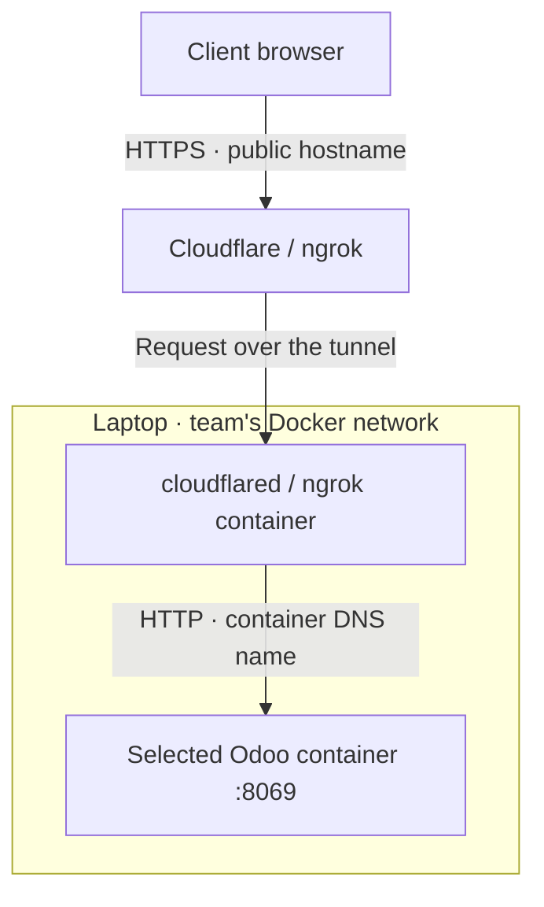

# Public Odoo links

Publish an Odoo development environment running on your laptop so a client can
open it over HTTPS. Oduflow starts the selected tunnel provider in Docker and
connects it to that environment's Odoo service. No router port forwarding or
locally installed tunnel binary is required.

The client signs in with an **Odoo account** and receives that account's normal
permissions. Publishing does not create a user, bypass Odoo login, or make an
account read-only. **Share UI** is a separate action for access to Oduflow's
environment dashboard; the public Odoo URL does not expose that dashboard,
Server settings, terminals, or the Oduflow MCP server.

## Publish from the dashboard

1. Open **Server settings → Tunnels** (`/admin`) and choose a provider. Enter
   its credentials, if required, then **Review & save**. These settings apply
   live; changing providers reconnects existing publications.
2. Start the Odoo environment. On its card, open **More → Publish Odoo**.
3. Leave **Hostname** empty to use the provider default, or enter an available
   hostname for managed Cloudflare/ngrok. Click **Publish**.
4. Wait for the public URL, copy it, and send it to the client together with
   their Odoo login details through your usual channel.
5. Use **Disable public link** to revoke access through the tunnel.

The operator's environment card shows two independent, clickable indicators:

| Indicator | Meaning | Click to |
|---|---|---|
| **Odoo published** | The tunnel reports a public Odoo link | Copy the URL or disable publication |
| **UI shared** | A dashboard access link has been created | Copy, regenerate or revoke the dashboard link |

Both indicators can appear together. Publication also shows **Odoo publishing**
while connecting, **Odoo paused** while stopped or the provider is disabled,
and **Tunnel error** when it needs attention. **Tunnel unknown** means the saved
publication state cannot be read. Disabling publication removes its indicator;
revoking a dashboard link removes **UI shared**. Indicators follow dashboard
refreshes and update after actions in either dialog.

**UI shared** does not establish an internet route to Oduflow. On a laptop its
link may still use a local address; the dashboard needs to be reachable by the
recipient separately. The Odoo tunnel does not publish the dashboard.

Keep the computer awake, online, and running Docker, Odoo, and the Oduflow
server during the review. Existing local Odoo addresses keep working.

This feature targets development environments with `workers = 0`, Oduflow's
default. A configuration with separate gevent workers is refused because
its bus/WebSocket traffic requires a second upstream. Production hosting
continues to use its own routing. On first publication Oduflow enables
`proxy_mode` in Odoo and restarts that container if necessary so HTTPS
redirects work. The proxy setting is retained on subsequent recreates.

## How requests reach the environment



Arrows show the request path. The connector establishes the connection to the
provider **outbound** from the laptop, so the router needs no incoming port
forwarding. The provider accepts the public HTTPS request and carries it back
over that connection.

When you publish an environment, Oduflow resolves its team and environment name
to its Odoo container and explicitly configures the destination, for example
`http://oduflow-1-demo-odoo:8069`. The connector joins that team's Docker network;
Docker DNS resolves the container name to its internal IP. Each environment has
its own container, so all can listen on `8069` without a port conflict.

- **Quick Tunnel:** a separate connector receives the selected Odoo address in
  its `--url` argument and gets an assigned public hostname.
- **Managed Cloudflare:** an ingress rule maps the public hostname to that
  Odoo address; a DNS record connects the hostname to the named tunnel.
- **ngrok:** each environment has an endpoint whose upstream is that Odoo
  address. One agent container per team can serve these endpoints.

This path goes directly to Odoo. It does **not** pass through Traefik or the
Odoo port published on the laptop. It works with Oduflow's port routing mode
as well as installations that also run Traefik. Odoo's `proxy_mode` lets it
recognize the original HTTPS request when generating redirects and URLs.

### Why port 8072 is not used

| Odoo mode | HTTP requests | WebSocket / bus | Supported by these tunnels |
|---|---|---|---|
| Default development mode, `workers = 0` | `8069` | Same HTTP port, `8069` | Yes |
| Multiple workers, `workers > 0` | `8069` | Separate gevent port, normally `8072` | No |

In the default threaded mode, Odoo serves WebSocket connections on its HTTP
listener. An additional `8072` route is unnecessary. With multiple workers,
the proxy must send `/websocket` (or `/longpolling` on older Odoo versions) to
the separate evented listener. The current tunnel implementation has one
upstream and refuses that configuration. See
[Odoo's deployment documentation](https://www.odoo.com/documentation/19.0/administration/on_premise/deploy.html)
for its worker and proxy modes.

## Choose a provider

| Provider | Setup | Address | Multiple environments |
|---|---|---|---|
| Cloudflare Quick Tunnel | No account or token | Temporary `*.trycloudflare.com` URL | Separate connector and URL per environment |
| Cloudflare Tunnel | Cloudflare API token, account ID, zone ID, domain | Hostname under your domain | Separate named tunnel and DNS record per environment |
| ngrok | ngrok agent authtoken; optional default hostname | Account-assigned or reserved hostname | Separate endpoints, subject to account domain and endpoint limits |

Only the selected provider is active. Provider changes stop the previous
connectors before opening new ones. Credentials for inactive providers can
remain in settings to make switching easier.

### Cloudflare Quick Tunnel

```toml
[tunnel]
provider = "cloudflare_quick"
```

Oduflow runs the official `cloudflare/cloudflared` image. Each new connector
receives a random hostname; stopping/recreating the connector, restarting
Oduflow, or restarting the computer can change it. Open **Publish Odoo** again
to copy the current link.

Quick Tunnels are intended for temporary testing, have a limit of 200 concurrent
in-flight requests, and do not support Server-Sent Events (SSE). Applications
or addons depending on SSE should use another provider. See
[Cloudflare's Quick Tunnel documentation](https://developers.cloudflare.com/tunnel/get-started/quick-tunnels/).

### Managed Cloudflare Tunnel

```toml
[tunnel]
provider = "cloudflare"
cloudflare_api_token = "<your-api-token>"
cloudflare_account_id = "<32-character-account-id>"
cloudflare_zone_id = "<32-character-zone-id>"
cloudflare_domain = "example.com"
```

Use a zone active in your Cloudflare account. The API token needs
**Account → Cloudflare Tunnel → Edit** for that account and
**Zone → DNS → Edit** for that zone. Oduflow creates a remotely managed tunnel,
configures its single Odoo route, obtains its connector token, and creates a
proxied CNAME automatically. A pre-created tunnel or manual `cloudflared login`
is not required. See the
[Cloudflare API setup guide](https://developers.cloudflare.com/cloudflare-one/networks/connectors/cloudflare-tunnel/get-started/create-remote-tunnel-api/).

The generated hostname includes the environment name and a random suffix.
An optional explicit hostname must be below `cloudflare_domain`; an existing
unrelated DNS record is never overwritten. Use the zone apex as the configured
domain, such as `example.com`, for ordinary one-level wildcard certificate
coverage. Deeper names require corresponding certificate coverage in Cloudflare.

Oduflow retains named tunnels and DNS across environment stops and recreates.
Disabling a link removes its connector and its owned remote resources. Cleanup
failures are shown in the publication dialog and retried. Keep the old account's
API token valid until cleanup finishes when switching accounts or providers.

### ngrok

```toml
[tunnel]
provider = "ngrok"
ngrok_authtoken = "<your-agent-authtoken>"
# Optional: use your account-assigned or reserved hostname.
ngrok_domain = "your-name.ngrok-free.app"
```

Use an **agent authtoken**, not an ngrok management API key. Oduflow runs the
official Alpine `ngrok/ngrok` image, with one agent per team and one endpoint
per published environment. Its management API listens only on loopback inside
the container and is reached through Docker exec; port 4040 is not published.

A fixed hostname can point to one environment at a time. The free plan's
assigned development domain therefore serves one selected environment in this
design. For several environments with distinct URLs, use a plan with sufficient
domains/endpoints and specify a different hostname for each publication.
Oduflow reports provider refusals rather than imposing its own paid-plan limit.
The free plan may show an ngrok browser interstitial. Consult
[ngrok's free-plan limits](https://ngrok.com/docs/pricing-limits/free-plan-limits)
for current quotas and behavior.

## Lifecycle

| Action | Public link behavior |
|---|---|
| Stop Odoo | Connector/endpoint is removed; publication preference is retained |
| Start Odoo | Publication is restored automatically |
| Recreate or update under the same name | Publication is restored; Quick Tunnel gets a new URL |
| Delete, rename, or failed full recreate | Publication is revoked; a future environment with the old name does not inherit it |
| Select Disabled | Connectors and owned remote resources are removed; publication preferences remain for later re-enabling |
| Stop Oduflow normally | Connectors are removed; desired publications are restored on next server start |

Reconciliation runs every five seconds while the HTTP or stdio server is
running, skips environments busy with other operations, and retries provider
errors with backoff. After a crash, Docker may keep connectors running;
the next Oduflow start reconciles them with the saved state.

Publication state and provider credentials needed for cleanup are stored in
`<data_dir>/.tunnels/registry.json`, with owner-only permissions. Connector
credentials are copied through the Docker API into private files in the
container; there are no additional host bind mounts. This also supports
Oduflow itself running in Docker. Protect this state like `oduflow.toml`.

## MCP and CLI

```bash
oduflow call publish_environment '{"env_name":"feature-login"}'
oduflow call get_environment_public_url '{"env_name":"feature-login"}'
oduflow call unpublish_environment '{"env_name":"feature-login"}'
```

`publish_environment` accepts an optional `hostname`. Responses contain
`provider`, `enabled`, `status`, `url`, `hostname`, and `error`; status may be
`starting` before a URL is available. `enabled` records the desired publication,
while `status` describes its current state. Keep the Oduflow server running
for automatic completion/retries and lifecycle restoration; `oduflow call`
alone performs only one attempt. Scoped environment MCP and Share UI sessions
cannot manage these publications.

REST uses `GET`, `POST`, and `DELETE` on
`/api/environments/{env_name}/public-odoo`. POST takes `{}` or
`{"hostname":"demo.example.com"}`. All three require the team's operator
session; callers cannot supply a target URL, port, or another team.
